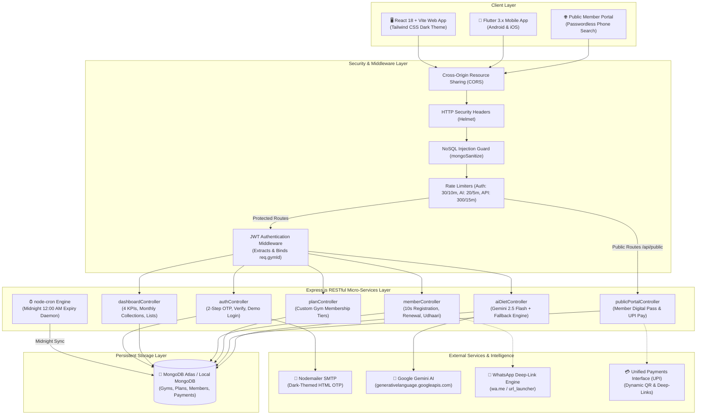
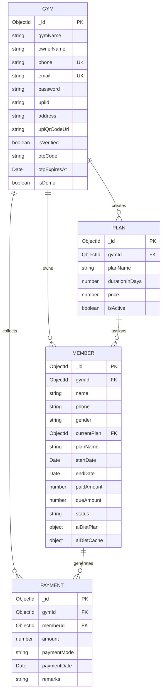

<div align="center">

# 🏋️‍♂️ GymFlow SaaS — Multi-Tenant Gym Management & AI Diet Platform

> **An enterprise-grade, multi-tenant Operating System engineered for Indian fitness centers.**  
> Features zero-cost **Hinglish WhatsApp Fee Reminders**, **Udhaari (Pending Dues) Tracking**, **2-Step Nodemailer Email OTP Onboarding**, **Dynamic UPI QR Billing**, and **Cached Gemini 2.5 AI Indian Diet Plans**.

---

[](https://nodejs.org/)
[](https://expressjs.com/)
[](https://react.dev/)
[](https://flutter.dev/)
[](https://www.mongodb.com/)
[](https://tailwindcss.com/)
[](https://jwt.io/)
[](https://nodemailer.com/)
[](https://ai.google.dev/)

---

[⚡ 1-Click Recruiter Demo](#-1-click-recruiter-demo-login) •
[🎯 Problem & Solution](#-the-real-world-problem--solution) •
[✨ Key Features](#-key-features-breakdown) •
[🏛️ System Architecture](#️-system-architecture-diagram) •
[🗄️ Database Schemas](#️-database-schema-overview) •
[📡 REST API Reference](#-complete-rest-api-reference) •
[🚀 Local Installation](#-local-installation--environment-setup)

---

</div>

## 🎯 The Real-World Problem & Solution

### ⚠️ The Problem: How Indian Gyms Operate Today
1. **Paper Registers & Excel Chaos:** Over 85% of tier-1, tier-2, and tier-3 Indian gym owners still record member registrations and renewal dates in paper logbooks or loose spiral notebooks.
2. **The "Silent Revenue Leak" (Forgotten Expiries):** Gym owners forget whose membership expired. Members keep working out for 2–3 weeks free of charge until someone manually remembers to check.
3. **Pending Dues (*Udhaari* Culture):** Gym goers frequently pay in partial instalments (e.g., paying ₹1,000 upfront out of a ₹1,500 monthly fee, promising *"Bhai baaki agle hafte dunga"*). Owners lose track of outstanding balances.
4. **Expensive SMS & WhatsApp API Gateways:** Traditional SaaS platforms charge thousands of rupees per month for Meta WhatsApp Cloud API access or Twilio SMS credits, making them unaffordable for independent gym owners.
5. **Generic Western Diet Plans:** Mainstream fitness software recommends avocado, salmon, turkey, and blueberries—completely irrelevant and unaffordable for average Indian lifters who rely on Sattu, Paneer, Soya Chunks, Dal, Sprouts, Eggs, and Roti.

### 💡 The Solution: GymFlow SaaS
- **Strict Multi-Tenant Isolation:** Multiple independent gyms run securely on a single backend infrastructure with strict cryptographic and query-level `gymId` partitioning.
- **Zero-Cost 1-Click WhatsApp Reminders:** Employs browser and native `wa.me` deep-linking to dispatch polite, Hinglish fee notices directly to the member's WhatsApp chat with zero monthly messaging costs.
- **Actionable 4-KPI Dashboard:** Instantly displays **Active Members**, **Expiring in 5 Days**, **Expired Members**, and total **Udhaari (Pending Dues ₹)**.
- **Automated Nightly Expiry Engine:** A background `node-cron` daemon evaluates timestamps every night at midnight to transition statuses seamlessly (`Active` ➔ `Expiring_Soon` ➔ `Expired`).
- **Dynamic UPI QR & Custom Scanner Support:** Onboard with custom UPI IDs and upload official QR scanner images (GPay, PhonePe, Paytm, BHIM) or rely on instant on-the-fly QR generation.
- **Localized Gemini 2.5 Flash Indian AI Diet Generator:** Formulates affordable, protein-dense vegetarian, eggetarian, and non-vegetarian Indian diet charts with 7-day in-database caching to eliminate API token waste.

---

## ⚡ 1-Click Recruiter Demo Login

No registration or manual database seeding is required to explore GymFlow:
1. Open the **Web App** (`http://localhost:5173`) or **Flutter Mobile App**.
2. Click the bright **"⚡ 1-Click Demo Login"** button on the login screen.
3. The platform instantly generates a demo session for **Iron Paradise Fitness Club** (`demo@gymflow.in`) pre-loaded with **20 realistic Indian members** spanning active memberships, upcoming expiries, overdue renewals, and pending *Udhaari* balances!

---

## ✨ Key Features Breakdown

### 1. 🏢 Multi-Tenant SaaS Architecture
- **Complete Tenant Isolation:** Every request to protected routes passes through `authMiddleware.js`. The decoded JWT injects `req.gymId`, guaranteeing that no gym owner can ever view, update, or delete another gym's members, plans, or revenue data.
- **Per-Tenant Configuration:** Individual gym names, owner details, customized membership tiers, UPI IDs, and QR codes are bound strictly to the tenant's ObjectId.

### 2. 🔐 2-Step Email OTP & UPI QR Onboarding
- **Step 1 — Registration Request:** Owner submits name, mobile number, email, password, gym name, UPI ID, and optional UPI QR scanner image.
- **Step 2 — Dark-Themed Nodemailer Email OTP:** An automated 6-digit verification code is delivered via Gmail SMTP using a responsive dark-themed HTML email template.
- **UPI QR Scanner Image:** Accepts base64 high-resolution uploads of official GPay/PhonePe/Paytm QR codes or auto-generates dynamic payment codes on the fly using standard `upi://pay?pa=...` standards.

### 3. 📊 Actionable Owner Dashboard
- **Top Metric Cards:**
  - 🟢 **Active Members:** Subscriptions valid beyond 5 days.
  - 🟡 **Expiring in 5 Days:** Actionable list with 1-click WhatsApp alerts.
  - 🔴 **Expired Members:** Subscriptions that have lapsed.
  - 🟠 **Pending Udhaari:** Total outstanding debts across all members.
  - 💰 **Monthly Revenue:** Total cash & UPI collections realized in the current calendar month.
- **Fast Filter Tabs:** Instantly toggle the Member Ledger by **All**, **Active**, **Expiring (≤ 5 Days)**, **Expired**, and **Udhaari Only**.

### 4. 💬 Zero-Cost 1-Click WhatsApp Reminders
- Generates localized, courteous Hinglish notifications via `wa.me/91<phone>?text=...`:
  - **Expiring Soon:** *"Namaste Rahul ji! 🙏 Aapki Iron Paradise Fitness ki gym membership agle 3 dino me expire hone wali hai. Continue rakhne ke liye UPI se renew karein: ironparadise@okaxis"*
  - **Expired with Pending Dues (*Udhaari*):** *"Namaste Amit ji! Aapki gym membership expire ho chuki hai aur ₹500 baaki hai. Please clear via UPI: ironparadise@okaxis"*
- Requires **zero third-party SMS/WhatsApp gateway fees**.

### 5. ⏰ Automated Nightly Expiry Engine
- Managed by `node-cron` running at **12:00 AM every midnight (`0 0 * * *`)**.
- Executes atomic bulk operations (`Member.updateMany`) comparing `endDate` against `new Date()` to seamlessly update membership flags across the entire database.

### 6. 📱 Public Member Portal & Cached Gemini AI Indian Diets
- **Passwordless Phone Lookup:** Gym members navigate to `/member-portal` (or enter their 10-digit mobile number) to view their digital membership pass, expiry countdown, payment history, and instant UPI pay link.
- **7-Day Gemini AI Diet Generator:** Generates customized Indian meal plans (Veg / Egg / Non-Veg) highlighting Paneer, Soya Chunks, Dal, Sprouts, Sattu, Eggs, Chicken, and Dahi. Cached in MongoDB for **7 days** to minimize Gemini API consumption.

---

## 🏛️ System Architecture Diagram



---

## 🗄️ Database Schema Overview



### 1. `Gym` Collection
| Field | Type | Modifiers / Constraints | Description |
|---|---|---|---|
| `_id` | ObjectId | Primary Key | Unique Gym Tenant Identifier |
| `gymName` | String | Required, Trim | Registered Business Name |
| `ownerName` | String | Required, Trim | Name of the Gym Owner / Manager |
| `phone` | String | Required, Unique, Trim | 10-digit mobile contact |
| `email` | String | Required, Unique, Lowercase | Login and OTP recipient email |
| `password` | String | Required | Salted bcrypt hash |
| `upiId` | String | Default: `ironparadise@okaxis` | VPA handle for receiving fees |
| `upiQrCodeUrl` | String | Base64 / Remote URL | Uploaded GPay/PhonePe scanner image |
| `isVerified` | Boolean | Default: `false` | Activated after 6-digit email OTP verification |
| `otpCode` | String | Optional | Ephemeral 6-digit verification token |
| `otpExpiresAt` | Date | Optional | 10-minute expiry timestamp |
| `isDemo` | Boolean | Default: `false` | Identifies pre-seeded demo gym |

### 2. `Plan` Collection
| Field | Type | Modifiers / Constraints | Description |
|---|---|---|---|
| `_id` | ObjectId | Primary Key | Unique Plan ID |
| `gymId` | ObjectId | Ref: `Gym`, Index | Multi-tenant tenant identifier |
| `planName` | String | Required, Trim | e.g. "1 Month", "3 Months", "1 Year Annual" |
| `durationInDays` | Number | Required, Default: `30` | Duration used for auto-computing `endDate` |
| `price` | Number | Required, Min: `0` | Base fee in Indian Rupees (₹) |
| `isActive` | Boolean | Default: `true` | Active status toggle |

### 3. `Member` Collection
| Field | Type | Modifiers / Constraints | Description |
|---|---|---|---|
| `_id` | ObjectId | Primary Key | Unique Member Record |
| `gymId` | ObjectId | Ref: `Gym`, Index | Tenant owner reference |
| `name` | String | Required, Trim | Member full name |
| `phone` | String | Required, Trim, Index | 10-digit mobile contact number |
| `gender` | String | Enum: `['Male', 'Female', 'Other']` | Member gender |
| `currentPlan` | ObjectId | Ref: `Plan`, Required | Assigned membership tier |
| `planName` | String | Default: `'1 Month General'` | Cached plan title |
| `startDate` | Date | Default: `Date.now` | Enrollment or renewal start date |
| `endDate` | Date | Required, Index | Calculated expiration date |
| `paidAmount` | Number | Default: `0`, Min: `0` | Cumulative amount paid (₹) |
| `dueAmount` | Number | Default: `0`, Min: `0` | Outstanding pending dues (*Udhaari*) |
| `status` | String | Enum: `['Active', 'Expiring_Soon', 'Expired']` | Current membership state |
| `aiDietPlan` | Object | `{ goal, dietType, generatedPlan, lastUpdated }` | Cached 7-day Indian gym diet |
| `aiDietCache` | Object | `{ goal, dietaryPreference, calories, dietText, generatedAt }` | Internal AI caching block |

> **🚀 Critical Performance Index:**  
> `MemberSchema.index({ gymId: 1, status: 1, endDate: 1 });`  
> Enables lightning-fast aggregate lookups across large member sets without disk-sort penalties.

### 4. `Payment` Collection
| Field | Type | Modifiers / Constraints | Description |
|---|---|---|---|
| `_id` | ObjectId | Primary Key | Unique Payment Receipt ID |
| `gymId` | ObjectId | Ref: `Gym`, Index | Tenant identifier |
| `memberId` | ObjectId | Ref: `Member`, Index | Member reference |
| `amount` | Number | Required, Min: `0` | Transaction value (₹) |
| `paymentMode` | String | Enum: `['UPI', 'Cash']` | Mode of settlement |
| `paymentDate` | Date | Default: `Date.now` | Payment timestamp |
| `remarks` | String | Optional | Audit note (e.g., "Registration fee", "Udhaari clearance") |

---

## 📡 Complete REST API Reference

### 🔐 Authentication (`/api/auth`)
| Method | Endpoint | Auth | Description |
|---|---|---|---|
| `POST` | `/api/auth/register` | None (Rate Limited) | **Step 1:** Validate details, create unverified gym, hash password, send 6-digit HTML email OTP via Nodemailer. |
| `POST` | `/api/auth/verify-otp` | None (Rate Limited) | **Step 2:** Verify 6-digit code, activate gym (`isVerified=true`), seed default plans, issue 30-day JWT. |
| `POST` | `/api/auth/resend-otp` | None (Rate Limited) | Resend fresh 6-digit verification code with renewed 10-minute validity. |
| `POST` | `/api/auth/login` | None (Rate Limited) | Authenticate with email/password; returns JWT and gym profile. |
| `POST` | `/api/auth/demo-login` | None | **⚡ 1-Click Demo Login:** Creates or loads "Iron Paradise Fitness" with 20 Indian members. |
| `GET` | `/api/auth/me` | Bearer JWT | Returns profile of the currently logged-in gym owner. |
| `PUT` | `/api/auth/profile` | Bearer JWT | Update gym name, owner name, phone, UPI ID, address, password, or upload UPI QR scanner image. |

### 📊 Dashboard & Analytics (`/api/dashboard`)
| Method | Endpoint | Auth | Description |
|---|---|---|---|
| `GET` | `/api/dashboard/stats` | Bearer JWT | Returns 4 KPIs (`activeCount`, `expiringSoonCount`, `expiredCount`, `totalPendingDues`), monthly revenue, and prioritized lists. |

### 🏋️‍♂️ Member Management (`/api/members`)
| Method | Endpoint | Auth | Description |
|---|---|---|---|
| `GET` | `/api/members` | Bearer JWT | List members with search query (`?search=`), status filter (`?filter=Active\|Expiring_Soon\|Expired\|Udhaari`), and sort (`?sort=`). |
| `POST` | `/api/members` | Bearer JWT | **10-Second Rapid Registration:** Auto-computes `endDate`, determines initial `dueAmount`, and creates a `Payment` record if paid > 0. |
| `PUT / POST`| `/api/members/:id/renew` | Bearer JWT | **1-Click Renewal:** Extends expiry from existing date (if active) or today (if expired), adjusts due amount, and logs payment. |
| `PUT / POST`| `/api/members/:id/clear-due` | Bearer JWT | **Clear Udhaari:** Deducts amount from member's `dueAmount`, adds to `paidAmount`, and logs a `Payment` entry. |
| `DELETE` | `/api/members/:id` | Bearer JWT | Permanently removes member and cascades payment history deletion. |
| `POST` | `/api/members/:id/ai-diet` | Bearer JWT | Generate or re-generate localized Indian gym diet plan via Gemini AI. |

### 📋 Membership Plans (`/api/plans`)
| Method | Endpoint | Auth | Description |
|---|---|---|---|
| `GET` | `/api/plans` | Bearer JWT | Fetch all active membership tiers configured for the tenant. |
| `POST` | `/api/plans` | Bearer JWT | Create a custom membership plan (`planName`, `durationInDays`, `price`). |
| `PUT` | `/api/plans/:id` | Bearer JWT | Update plan title, pricing, or duration. |
| `DELETE` | `/api/plans/:id` | Bearer JWT | Soft/Hard remove membership tier for this gym. |

### 🌐 Public Member Portal (`/api/public`)
| Method | Endpoint | Auth | Description |
|---|---|---|---|
| `GET` | `/api/public/member/:phone` | None (Public) | Lookup membership status, days left, receipt history, and dynamic UPI pay link by 10-digit mobile number. |
| `POST` | `/api/public/member/:id/diet` | None (Public) | Fetch cached 7-day Indian diet plan or generate a fresh one via Gemini 2.5 Flash if cache has expired (> 7 days). |

---

## 🚀 Local Installation & Environment Setup

### 📋 Prerequisites
- **Node.js:** v18.x or v20.x installed
- **npm:** v9.x or higher
- **MongoDB:** MongoDB Atlas connection URI or local MongoDB daemon running on `mongodb://localhost:27017`
- **Flutter SDK (Optional for mobile):** v3.16.x or higher

---

### Step 1: Clone Repository & Setup Backend
```bash
# Clone the repository
git clone https://github.com/your-username/gym_sasapp.git
cd gym_sasapp/backend

# Install backend dependencies
npm install
```

#### Backend Environment Variables Configuration (`/backend/.env`)
Create a `.env` file inside `/backend` modeled on the template below:

| Variable | Required | Example Value | Description |
|---|---|---|---|
| `PORT` | Optional | `5000` | HTTP port for the Express backend API |
| `MONGODB_URI` | **Required** | `mongodb://127.0.0.1:27017/gymflow_db` | MongoDB Atlas cluster or local URI |
| `JWT_SECRET` | **Required** | `gymflow_super_secret_jwt_key_2026_fitness_saas` | Cryptographic secret for signing tokens |
| `GEMINI_API_KEY` | Optional | `AIzaSyD...` | Google Gemini API key for Indian diet generation |
| `NODE_ENV` | Optional | `development` | Environment mode (`development` or `production`) |
| `CLIENT_URL` | Optional | `http://localhost:5173` | Allowed frontend origin for CORS |
| `EMAIL_USER` | Optional | `yourgymflow@gmail.com` | Gmail address for dispatching registration OTPs |
| `EMAIL_PASS` | Optional | `abcd efgh ijkl mnop` | Google 16-character App Password |

```bash
# Optional: Seed 20 realistic Indian members into demo gym
node seed.js

# Start the Backend Server (with hot reloading via nodemon)
npm run dev
# Server will run at http://localhost:5000
```

---

### Step 2: Setup & Run React Web Frontend
Open a new terminal window:
```bash
cd gym_sasapp/web-frontend

# Install dependencies
npm install

# Start Vite Development Server
npm run dev
# Web app will be accessible at http://localhost:5173
```

---

### Step 3: Setup & Run Flutter Mobile App (Android / iOS)
Open a new terminal window:
```bash
cd gym_sasapp/flutter_app

# Fetch Flutter dependencies
flutter pub get

# Check connected physical device or emulator
flutter devices

# Launch the app
flutter run
```

---

## 💡 Technology Stack Summary

| Domain | Technology / Library | Purpose |
|---|---|---|
| **Backend Runtime** | Node.js & Express.js | High-throughput, asynchronous RESTful API |
| **Database** | MongoDB Atlas & Mongoose | Flexible document schema with compound indexing |
| **Authentication** | JSON Web Tokens (JWT) & bcryptjs | Stateless, multi-tenant session verification |
| **Email Service** | Nodemailer (Gmail SMTP) | Automated dark-mode HTML verification OTP emails |
| **Artificial Intelligence** | Google Gemini 2.5 Flash API | Hyper-localized Indian sports nutrition generator |
| **Task Scheduler** | node-cron | Automated midnight membership status synchronization |
| **Web Frontend** | React.js 18, Vite, Lucide Icons | Responsive SPA with glassmorphism & neon aesthetics |
| **Styling** | Vanilla Tailwind CSS (Dark Slate Theme) | Responsive UI with custom utility tokens |
| **Mobile App** | Flutter & Dart (Dio, Provider, Url Launcher) | Native Android & iOS cross-platform application |
| **Messaging** | WhatsApp Deep-Linking (`wa.me`) | Zero-cost Hinglish automated fee reminder engine |

---

<div align="center">

**Built with passion for Indian fitness entrepreneurs.**  
⭐ Star this repository if GymFlow inspires your SaaS architecture!

</div>
# GYM_Flow

